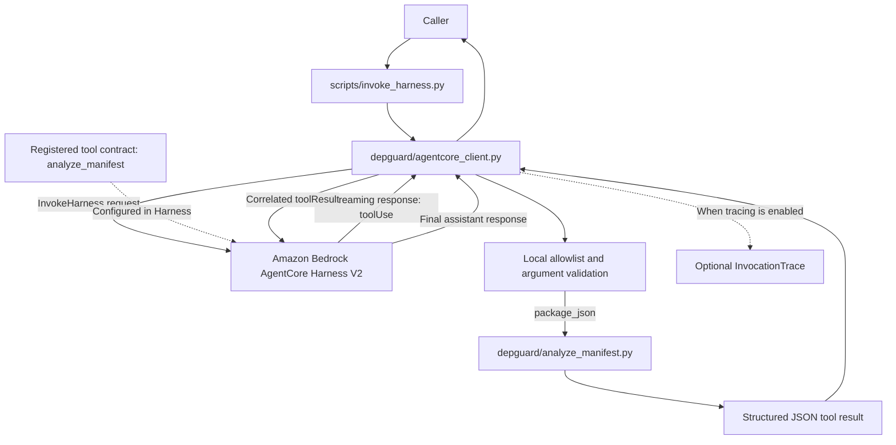

# DepGuard Sentinel - Architecture and Trust Boundaries

- **Document type:** Technical architecture and security boundary specification
- **Project:** DepGuard Sentinel
- **Architecture snapshot:** November 22, 2026
- **Harness generation:** AgentCore Harness V2
- **Status:** Implemented prototype with local unit tests and selected AWS LIVE evidence

---

## 1. Purpose and Scope

This document describes the implemented DepGuard Sentinel execution architecture, its trust boundaries, the local tool-dispatch mechanism, the manifest-analysis component, and the evidence available for its security controls.

The primary workflow is a read-only analysis of caller-supplied npm `package.json` content.

The system combines:

- Amazon Bedrock AgentCore Harness V2 as the managed agent orchestration layer.
- A local Python client that invokes the Harness and processes streaming tool handoffs.
- A deterministic, local Python function named `analyze_manifest`.
- Unit tests, Red Team scenarios, and recorded AWS LIVE invocation evidence.

The Harness declares an `inline_function` tool. The declaration does not mean that the Harness executes the Python implementation. The registered tool description explicitly states that the function runs in the caller application. The local Python client performs the actual dispatch and execution.

This document covers the primary Harness invocation path. The repository also contains separate local approval-binding and approval-handler components, validation modules, confidentiality checks, an HTTP adapter, and Red Team components. These auxiliary components are exercised through separate local or adapter test paths; they are not registered tools in the inspected primary Harness configuration and are not invoked by the primary CLI analysis workflow.

The primary Harness analysis workflow is not a production Software Composition Analysis (SCA) platform, vulnerability scanner, package manager, or package-approval workflow. Separate local approval-related components exist in the repository, but they are not exposed by the inspected primary Harness tool configuration and are not invoked by the primary `analyze_manifest` invocation path.

## 2. Architecture at a Glance

### 2.1 Logical Components

| Component | Implementation | Responsibility |
|---|---|---|
| Managed agent orchestration | Amazon Bedrock AgentCore Harness V2 | Receives prompts, applies configured system instructions, and emits assistant responses or tool handoffs |
| Harness tool declaration | `analyze_manifest`, type `inline_function` | Defines the tool name, description, and input contract; it does not execute the local Python implementation |
| Local invocation entry point | `scripts/invoke_harness.py` | Parses CLI options, creates the boto3 client, and starts an invocation |
| Local protocol client | `depguard/agentcore_client.py` | Consumes the stream, validates tool dispatch, executes the allowed function, and sends correlated tool results |
| Manifest analyzer | `depguard/analyze_manifest.py` | Parses and normalizes untrusted manifest data without external side effects |
| Red Team adapter | `scripts/redteam_adapter.py` | Provides scenario orchestration and component-level testing paths; it is not the primary CLI execution path |
| Evidence and tests | `tests/`, `artifacts/`, `docs/` | Provide regression tests, security evaluations, and evidence records |

### 2.2 High-Level Architecture

The following diagram represents the primary execution path. The Harness declares the tool contract, while the local Python client performs tool dispatch and execution.

The tool declaration is a configuration contract, not a separate execution service. The local client receives the handoff, validates it, and invokes the Python analyzer.

## 3. Managed Harness Configuration

### 3.1 Observed Runtime Configuration

The following values were obtained from a local Harness inspection snapshot dated November 21, 2026 (`harness-inspection-20261121.json`). This is a point-in-time configuration record and does not guarantee that the remote configuration has remained unchanged.

| Property | Observed value |
|---|---|
| Harness name | `DepGuardSentinel` |
| Harness version | `2` |
| Observed status | `READY` |
| Model | `amazon.nova-lite-v1:0` |
| Model API format | `converse_stream` |
| Model maximum tokens | `1200` |
| Model temperature | Approximately `0.1` |
| Maximum Harness iterations | `3` |
| Harness timeout | `90` seconds |
| Conversation truncation | `sliding_window` |
| Sliding window message count | `8` |
| AgentCore memory | Disabled |
| Runtime network mode | `PUBLIC` |
| Idle runtime session timeout | `300` seconds |
| Runtime maximum lifetime | `1800` seconds |

The inspected AgentCore runtime configuration reports `networkMode: PUBLIC`. This setting must not be interpreted as network isolation or as an egress restriction. The read-only and network-free properties of the local analyzer are established by its implementation, not by this runtime network setting.

### 3.2 Registered Tool Contract

The inspected Harness configuration registers one tool:

| Property | Observed value |
|---|---|
| Tool name | `analyze_manifest` |
| Tool type | `inline_function` |
| Allowed tool identifier | `@analyze_manifest` |
| Required argument | `package_json` |
| Argument type | `string` |
| Additional properties | Not allowed |
| Agent skills | None |

The registered input schema requires a JSON object with one string property named `package_json`. The property is mandatory, and additional properties are not allowed.

The registered tool description explicitly states that the function runs in the caller application, not in the Harness. The Harness declares the tool contract and emits a tool handoff. The local Python client receives that handoff and performs the actual function dispatch.

The local client independently enforces the tool name and requires the outer argument object to contain exactly one property: `package_json`. This provides a local enforcement boundary in addition to the Harness-declared input schema.

## 4. Runtime Invocation and Tool Handoff

### 4.1 Invocation Entry Point

The primary command-line entry point is `scripts/invoke_harness.py`.

Its responsibilities include:

1. Parse command-line options and environment configuration.
2. Obtain the Harness ARN from `DEPGUARD_HARNESS_ARN` or `--harness-arn`.
3. Select the AWS profile and Region.
4. Generate a runtime session identifier when one is not supplied.
5. Validate the Harness ARN before invocation.
6. Support a `--dry-run` mode that validates the Harness ARN and prints selected settings without contacting AWS. The dry-run path does not call `validate_session_id()`; session validation is performed by `invoke_with_inline_tool()` during a real invocation, before the initial Harness request.
7. Import boto3 only when a real AWS invocation is requested.
8. Create a boto3 session and a `bedrock-agentcore` service client.
9. Invoke `invoke_with_inline_tool()` from the local protocol client.
10. Print the final assistant response.

The default AWS profile is `depguard-admin`, and the default Region is `us-east-1`. Both can be overridden through command-line arguments or their corresponding environment variables.

The default runtime session identifier is generated locally using a `dg-` prefix followed by a UUID hexadecimal value. The invocation client validates the session identifier before making the Harness request.

The CLI supports both an explicit `--prompt` argument and interactive prompt entry. AWS credential resolution is delegated to the boto3 session and the configured AWS profile.

### 4.2 Streaming and Handoff Processing

The `consume_stream()` function in `depguard/agentcore_client.py` processes the event stream returned by `invoke_harness()`.

It extracts the following information:

- Assistant text fragments from `contentBlockDelta` events.
- The `toolUseId` and tool name from a `contentBlockStart` event.
- The content block index associated with the tool handoff.
- Initial tool input when supplied as a string.
- Subsequent tool input fragments from matching `contentBlockDelta` events.
- The final message stop reason from `messageStop`.

Tool input fragments are accumulated in order and associated with the selected tool content block. The client enforces a 256 KiB UTF-8 encoded input limit while collecting the streamed tool input.

The client rejects more than one tool handoff in a single stream. This prevents a single invocation response from dispatching multiple tool requests through this handler.

The stream consumer also handles runtime error events:

| Event | Client behavior |
|---|---|
| `runtimeClientError` | Captures a bounded runtime error message |
| `validationException` | Records a Harness invocation validation failure |
| `internalServerException` | Records an AgentCore internal server error |

When a runtime error is detected, `consume_stream()` raises `HarnessInvocationError` instead of returning a normal handoff state.

The function itself parses the stream and collects the handoff data. Tool authorization and execution are performed later by `invoke_with_inline_tool()`.

### 4.3 Handoff Dispatch and Result Correlation

The `invoke_with_inline_tool()` function coordinates the complete tool handoff lifecycle.

After consuming a Harness stream with a `tool_use` stop reason, the client performs the following checks:

1. Record the tool name, tool-use identifier, and input size when tracing is enabled.
2. Enforce the configured local handoff limit.
3. Require a non-empty `toolUseId` and tool name.
4. Compare the requested tool name against the local allowlist.
5. Execute the permitted local function only after the checks pass.

An unexpected tool name causes `HarnessInvocationError`. The client records the blocked tool name when tracing is enabled, does not call the local executor, and does not send a `toolResult` for that request.

For an authorized `analyze_manifest` handoff, the client invokes `execute_inline_tool()` with the reconstructed input.

The local execution result is mapped to the Harness protocol:

| Local execution status | Tool-result protocol status |
|---|---|
| `OK` | `success` |
| `REJECTED` | `success` |
| `ERROR` | `error` |

A validation rejection is a completed tool operation that reports invalid input. It is therefore returned using protocol status `success`, while preserving the local `REJECTED` status and its validation details.

Unexpected exceptions are converted into a structured `ERROR` result. Internal exception details and stack traces are not forwarded to the model.

The client sends the result with the original `toolUseId` and reuses the same `runtimeSessionId` for the follow-up Harness invocation. It sends the matching `toolResult` message rather than replaying the original assistant tool-use event.

The local handoff limit defaults to three and can be configured between one and ten. This limit is enforced by the Python client and is separate from the Harness configuration's maximum iteration setting.

A final response is accepted when the Harness stop reason is `end_turn` or `stop_sequence`. Other stop reasons are treated as unsuccessful invocation termination.

## 5. Local Manifest Analyzer

### 5.1 Execution Properties

The local analyzer is implemented in `depguard/analyze_manifest.py` and exposes the following function:

`analyze_manifest(package_json: str) -> dict[str, Any]`

The function receives the raw JSON text supplied by the caller and returns a structured, JSON-serializable analysis result.

The implementation uses Python standard-library modules and performs deterministic, read-only processing of the supplied manifest.

The analyzer does not:

- Install or update packages.
- Execute package scripts, shell commands, or arbitrary code.
- Read local files or environment variables.
- Access package registries, external APIs, or network resources.
- Resolve, download, or follow dependency references.
- Modify the supplied manifest or perform external state changes.
- Query vulnerability databases or security advisories.
- Grant package approval or initiate quarantine actions.

All manifest content remains untrusted input. Successful parsing does not establish the authenticity, integrity, safety, or trustworthiness of a package.

The analyzer produces an inventory and security review indicators. It does not make an authorization decision or certify that a dependency is free of vulnerabilities.

### 5.2 Input Validation and Resource Limits

The analyzer applies explicit input and resource limits before producing a dependency inventory.

| Control | Configured limit |
|---|---:|
| Manifest UTF-8 encoded size | 256 KiB |
| Maximum dependency entries | 2,000 |
| Maximum package name length | 214 characters |
| Maximum dependency specifier length | 256 characters |
| Metadata string traversal depth | 100 levels |

The input validation path applies the following checks:

1. The supplied value must be a string.
2. The input must not be empty.
3. The text must be encodable as strict UTF-8.
4. The encoded manifest must not exceed the configured size limit.
5. The content must be valid strict JSON.
6. Duplicate JSON object keys are rejected.
7. Non-standard JSON constants are rejected.
8. The parsed root value must be a JSON object.

Invalid input is returned as a structured rejection with `status: REJECTED`, `decision: DENY`, and a machine-readable validation error code.

The JSON parser handles malformed input and recursion errors as invalid manifest input. The metadata scanner uses an iterative traversal and skips string values beyond its configured depth bound.

These limits reduce exposure to malformed or oversized input. They do not constitute a general-purpose denial-of-service defense for every possible runtime or infrastructure condition.

### 5.3 Dependency Sections and Inventory

The analyzer examines four dependency sections from the root manifest object:

| Manifest section | Purpose |
|---|---|
| `dependencies` | Runtime dependencies |
| `devDependencies` | Development dependencies |
| `optionalDependencies` | Optional dependencies |
| `peerDependencies` | Peer dependencies |

A dependency section that is absent is treated as an empty object. When a section is present, its value must be a JSON object. Other value types are rejected with `INVALID_DEPENDENCY_SECTION`.

For each dependency entry, the analyzer validates the package name and classifies its declared specifier. The resulting inventory records:

- Package name.
- Original declared specifier.
- Source dependency section.
- Specifier classification.
- Associated risk indicator.

The summary includes the total number of dependency entries, the number of unique package names, and the number of entries found in each dependency section.

The total dependency count represents manifest entries, while the unique dependency count is calculated from distinct package names across all four sections. A package name declared in more than one section therefore contributes multiple entries but only one unique package name.

### 5.4 Package Name Validation

Each dependency name is validated before it is added to the inventory.

The analyzer supports two npm package-name formats:

- Unscoped names, such as `lodash` or `express`.
- Scoped names, such as `@types/node`.

The validation rules include:

1. The package name must be a string.
2. The name must not be empty or exceed 214 characters.
3. Uppercase characters are rejected.
4. Leading or trailing whitespace is rejected.
5. Control characters are rejected.
6. Path-like, wildcard, ARN-like, and unsupported identifier formats are rejected.
7. Scoped names must follow the `@scope/name` structure.

The implementation uses regular expressions to validate unscoped and scoped package-name formats. It does not resolve package names against npm or verify that a package exists in a registry.

Invalid names produce `INVALID_PACKAGE_NAME` and cause the manifest analysis to return a structured rejection.

### 5.5 Dependency Specifier Classification

The analyzer classifies dependency specifiers without resolving package versions or contacting external registries.

Before classification, each specifier must be a non-empty string within the configured 256-character limit. Leading or trailing whitespace and control characters are rejected.

The implementation recognizes the following categories:

| Classification | Examples | Risk indicator |
|---|---|---|
| `EXACT_VERSION` | `4.17.21`, `1.2.3-beta.1` | `NONE` |
| `SEMVER_RANGE` | `^4.17.21`, `~1.2.3`, `1.x` | `NONE` |
| `DIST_TAG` | `latest`, `next`, `beta` | `NON_PINNED_OR_EXTERNAL_REFERENCE` |
| `NPM_ALIAS` | `npm:some-package@1.2.3` | `NON_PINNED_OR_EXTERNAL_REFERENCE` |
| `NON_REGISTRY_REFERENCE` | `file:`, `git+`, `https:`, `workspace:` | `NON_PINNED_OR_EXTERNAL_REFERENCE` |

Exact versions are matched against a dedicated semantic-version pattern. Range specifiers are classified using an allowed-character pattern; this is not a complete semantic validation or resolution of the range.

Dist-tags are treated as mutable references. npm aliases and recognized non-registry references are surfaced as risk indicators rather than automatically rejected.

External references are recorded as data only. The analyzer does not retrieve, resolve, follow, or download them.

Unsupported specifier formats produce `INVALID_PACKAGE_SPECIFIER` and cause a structured manifest rejection.

These classifications describe declared dependency references. They do not establish the resolved version, package integrity, registry provenance, or vulnerability status.

### 5.6 Untrusted Metadata Scanning

The analyzer scans string values throughout the parsed manifest for suspicious instruction-like or verdict-like content.

The implementation uses an iterative traversal with a maximum depth of 100 levels. It examines string values, including values in metadata fields that are not part of the four dependency sections. JSON object keys are not scanned.

The current detector defines six pattern categories:

| Finding code | Detection purpose |
|---|---|
| `PROMPT_OVERRIDE_TEXT` | Detects language attempting to ignore, disregard, or override previous, prior, or system instructions |
| `SYSTEM_NOTE_MARKER` | Detects markers resembling `[SYSTEM NOTE]`, `[SYSTEM MESSAGE]`, or `[SYSTEM INSTRUCTION]` |
| `TOOL_EXECUTION_REQUEST` | Detects text requesting execution of `approve_package()` |
| `ALERT_SUPPRESSION_REQUEST` | Detects requests to erase, delete, hide, or suppress security alerts |
| `BACKEND_VERDICT_MIMIC` | Detects text imitating a backend verdict |
| `APPROVAL_CLAIM_MIMIC` | Detects text imitating an `approvedBy` field |

Each detected pattern produces a finding with:

- A stable finding code.
- Severity `REVIEW`.
- The manifest field path where the text was detected.
- A generic message identifying suspicious instruction-like or verdict-like metadata.

The scanner deduplicates findings by pattern code and field path. Multiple matches of the same pattern in the same field therefore produce one finding for that pair.

Detected text remains untrusted metadata. The scanner does not execute instructions, invoke tools, verify approval claims, or establish that the package is malicious.

The detector is heuristic and pattern-based. It is not a complete prompt-injection classifier and does not guarantee detection of paraphrased, obfuscated, or previously unknown attacks.

### 5.7 Analysis Result Semantics

The analyzer returns a JSON-serializable object with a consistent result structure.

| Field | Purpose |
|---|---|
| `status` | Indicates whether analysis completed or input was rejected |
| `decision` | Identifies the analysis outcome; it does not represent package approval |
| `trust_state` | Preserves the untrusted status of caller-supplied manifest content |
| `validation` | Contains the input rejection flag and structured validation errors |
| `manifest` | Contains the observed manifest name and version |
| `dependencies` | Contains the normalized dependency inventory |
| `summary` | Contains aggregate dependency counts and detection indicators |
| `findings` | Contains suspicious metadata findings |
| `risk_indicators` | Contains aggregate dependency and metadata risk signals |

The main result states have the following meanings:

| Result state | Meaning |
|---|---|
| `OK` | The manifest passed the implemented structural checks and analysis completed |
| `REJECTED` | The supplied input or manifest failed validation |
| `ANALYZE_ONLY` | The analyzer produced an inventory without authorizing an action |
| `DENY` | The input was rejected; this is not a package quarantine or remediation action |
| `TAINTED` | The supplied manifest remains untrusted, regardless of whether suspicious patterns were detected |

For successful analysis, the summary reports dependency counts, counts by dependency section, suspicious-content detection, non-registry references, and mutable specifiers.

Validation failures return structured error codes and messages. The analyzer does not convert a rejected manifest into an approved or trusted result.

A result with no findings or risk indicators is not evidence that a package is safe. It only means that the implemented checks did not report those indicators for the supplied manifest.

## 6. Trust Boundaries

### 6.1 Caller to Harness

The first trust boundary exists between the caller and the managed AgentCore Harness.

The caller may submit prompts and package manifest content containing attacker-controlled data, including:

- Malicious or misleading package metadata.
- Instruction-like strings and prompt injection attempts.
- Forged approval claims or backend verdicts.
- Suspicious URLs and dependency references.
- Requests to override the configured agent role or permitted capabilities.

All caller-supplied manifest content must remain untrusted data, regardless of whether it is syntactically valid JSON or contains apparently authoritative statements.

The Harness system instructions direct the agent to ignore embedded instructions that attempt to change its role, modify tool permissions, suppress findings, disclose secrets, or trigger unauthorized actions.

These instructions are a model-behavior control. They do not independently enforce input validation, network isolation, AWS IAM restrictions, or local execution authorization.

The local Python client provides the separate enforcement boundary for tool dispatch. A prompt or manifest statement cannot add a new executable tool to its local allowlist.

### 6.2 Harness to Local Python Client

The second trust boundary exists between the managed Harness and the local Python client.

The client receives streamed events from `invoke_harness()`. A tool handoff is treated as untrusted dispatch data and is not executed solely because it was emitted by the Harness.

The local client applies the following controls:

1. Reconstructs tool input from the matching content block.
2. Rejects multiple tool handoffs in a single stream.
3. Enforces the 256 KiB UTF-8 encoded tool-input limit.
4. Requires a non-empty tool-use identifier and tool name before dispatch.
5. Compares the requested tool name against the local allowlist.
6. Rejects unexpected tool names before local execution.

Only `analyze_manifest` is permitted by the current local dispatch implementation.

An unexpected tool request raises `HarnessInvocationError`. The client does not invoke the local executor and does not send a fabricated `toolResult` for the unsupported tool.

This boundary is enforced by application code rather than relying exclusively on the Harness system prompt or registered tool declaration.

The local client does not independently validate the authenticity of the Harness event stream. It relies on the configured AWS SDK client and the underlying AWS service interaction for that transport and service boundary.

### 6.3 Local Client to Manifest Analyzer

The third trust boundary exists between the local tool dispatcher and the manifest analyzer.

The dispatcher parses the outer tool argument payload as JSON and requires an object containing exactly one property: `package_json`.

The value is passed to `analyze_manifest()`, which performs its own independent validation of the manifest text.

The two validation layers serve different purposes:

| Layer | Responsibility |
|---|---|
| Outer tool argument validation | Enforces the local tool-call contract and rejects unexpected arguments |
| Manifest validation | Checks JSON syntax, duplicate keys, root type, dependency sections, package names, specifiers, and analyzer resource limits |

The analyzer treats all parsed manifest values as untrusted data. It does not interpret metadata as executable instructions or as authorization evidence.

A successful analysis returns an inventory and review indicators. Invalid input returns a structured rejection. Neither outcome grants permission to install, approve, quarantine, or modify a package.

The analyzer is a local Python function invoked directly by the client. It is not a separately deployed Lambda function or an independently exposed network service in this primary workflow.

### 6.4 Local Client to Harness Result

The fourth trust boundary exists when the local client returns an analysis result to the managed Harness.

The client serializes the structured local result as JSON text inside a `toolResult` message.

Two correlation values are preserved:

- `toolUseId`: the identifier received in the corresponding Harness tool handoff.
- `runtimeSessionId`: the same runtime session identifier used for the initial invocation.

The returned tool result contains the local analysis status, decision, trust state, validation details, dependency inventory, findings, and risk indicators, as applicable.

The protocol status describes tool execution completion rather than package acceptance:

- A local `OK` result is returned with protocol status `success`.
- A local `REJECTED` result is also returned with protocol status `success`, because validation completed and produced a structured rejection.
- A local `ERROR` result is returned with protocol status `error`.

The Harness then processes the correlated tool result and may produce a final assistant response.

The assistant response is expected to explain the supplied evidence. It does not transform the analyzer result into an approval, vulnerability assessment, or authorization to perform external actions.

The local client returns final response text when the Harness ends with `end_turn` or `stop_sequence`.

### 6.5 Execution Evidence Boundary

The final trust boundary concerns the collection and interpretation of execution evidence.

The primary client defines an optional `InvocationTrace` structure with the following fields:

| Field | Recorded information |
|---|---|
| `tool_requests` | Tool name, tool-use identifier, and input size |
| `tool_results` | Tool name, tool-use identifier, and structured local result |
| `blocked_tool_names` | Names of unexpected tools rejected by the client |
| `final_stop_reason` | Last recorded Harness stop reason |

The trace is an application-level evidence structure. Its presence does not independently authenticate the remote execution environment or prove that an external side effect did not occur.

Evidence is collected through three distinct verification levels:

1. Local unit tests exercise individual functions and client behavior using controlled inputs and test doubles.
2. Simulated integration tests exercise production client logic with mocked Harness responses. They verify local behavior under the supplied event sequence but do not represent AWS LIVE execution.
3. AWS LIVE tests invoke the configured managed Harness and record observed tool handoffs, local execution results, protocol responses, and final assistant output to the extent captured by each report.

These evidence types support different claims and must not be treated as interchangeable.

In particular, a test that confirms an unauthorized tool was not emitted by the managed Harness does not prove that the local client blocks an emitted unauthorized handoff. That enforcement path requires a separate test that supplies such a handoff to the client.

Evidence reports must preserve the distinction between directly observed events, locally inferred outcomes, evaluator assertions, and fields that were not captured or verified.

## 7. Security Control and Verification Matrix

### 7.1 Local Regression Test Coverage

The local regression suite covers the primary invocation client, manifest analyzer, and selected Red Team evaluators.

The following test files provide direct coverage of the primary read-only analysis workflow:

| Test file | Test methods | Primary coverage |
|---|---:|---|
| `tests/test_agentcore_client.py` | 16 | Stream processing, session validation, tool allowlist, argument validation, handoff correlation, and protocol status mapping |
| `tests/test_analyze_manifest.py` | 22 | Manifest parsing, dependency inventory, name and specifier validation, resource limits, duplicate keys, and suspicious metadata |
| `tests/test_stress_test_t06.py` | 4 | Evaluation of the read-only decision and reported absence of approval or mutation |

Additional tests cover multi-turn behavior, unauthorized tool requests, Red Team adapters, approval components, and confidentiality checks. Those tests exercise separate repository components and must not be interpreted as additional tools registered in the primary Harness.

The V8 full-suite verification record reports:

- 136 tests executed.
- 0 failures.
- 0 errors.
- Test output: `artifacts/unit-tests-v8-tool-allowlist-20261122.txt`.
- Verification metadata: `artifacts/unit-tests-v8-tool-allowlist-20261122.meta.json`.

The V8 run was performed against source commit `69966002dc6ecdf49e67385bb5179d088567e8a7`.

A passing unit test demonstrates the behavior covered by its assertions and test setup. It does not independently prove the absence of all possible runtime, infrastructure, or external side effects.

### 7.2 AWS LIVE and Simulated Verification Evidence

The project has recorded AWS LIVE invocations against the configured AgentCore Harness, as well as a separate simulated client-integration test.

| Evidence report | Verification scope | Observed outcome |
|---|---|---|
| `artifacts/live-agentcore-smoke-test-20261122.json` | AWS LIVE smoke test | One `analyze_manifest` handoff, one local result, and final `end_turn` |
| `artifacts/live-agentcore-dependencies-test-20261122.json` | AWS LIVE dependency inventory | Four declared dependencies inventoried; final response reported vulnerability assessment as `NOT_ASSESSED` |
| `artifacts/redteam-t10-live-malformed-json-20261122.json` | AWS LIVE malformed-input test | Local `REJECTED` result with `INVALID_JSON`; outgoing tool-result protocol status was `success` |
| `artifacts/redteam-t11-live-prompt-injection-20261122.json` | AWS LIVE untrusted-metadata test | Suspicious metadata findings were returned and preserved in the tool result |
| `artifacts/redteam-t12-live-unauthorized-tool-not-exposed-20261122.json` | AWS LIVE unauthorized-tool availability test | The Harness did not emit an unauthorized tool handoff |
| `artifacts/redteam-t12-sim-unauthorized-tool-handoff-20261122.json` | Simulated client-integration test | A mocked `approve_package` handoff was blocked before local execution or tool-result submission |

The evidence has the following qualifications:

- The initial smoke-test and dependency-inventory reports did not directly capture the outgoing protocol `toolResult` status.
- T10 recorded an input-fidelity variance. The rejection outcome was observed, but exact equality between the intended and received malformed input was not fully established.
- T11 confirmed receipt of the suspicious marker and the expected findings, but did not verify full manifest equality.
- T12 LIVE demonstrates that the tested Harness did not expose or emit the unauthorized tool request. It does not exercise the local client's fail-closed path for an emitted unauthorized handoff.
- T12-SIM exercises the production client with a mocked Harness response. It is simulated integration evidence, not an AWS LIVE execution.

The T12 LIVE and T12-SIM reports therefore support different security claims and must not be combined into a single live fail-closed assertion.

Artifact hashes, source commits, evidence commits, and detailed validation results are maintained in `docs/security-evidence-index-20261122.md`.

### 7.3 Security Control Traceability Matrix

The following matrix maps the principal security controls to their implementation and available verification evidence.

| Security control | Implementation | Local verification | Remote or additional evidence |
|---|---|---|---|
| Harness ARN and session validation | `validate_harness_arn()` and `validate_session_id()` | Valid and malformed value tests in `test_agentcore_client.py` | CLI dry-run validates the Harness ARN; session validation occurs before a real Harness request |
| Streamed tool-input reconstruction | `consume_stream()` | `test_consume_stream_collects_inline_tool_input` | Observed in AWS LIVE handoff reports |
| Single handoff per stream | `consume_stream()` | `test_rejects_multiple_tool_handoffs_in_one_stream` | No separate adversarial LIVE assertion recorded |
| Streamed input size limit | `_append_tool_input()` | `test_rejects_oversized_streamed_tool_input` | Local enforcement; no separate LIVE limit test recorded |
| Tool allowlist | `execute_inline_tool()` and `invoke_with_inline_tool()` | `test_executes_only_analyze_manifest`, `test_rejects_unknown_tool`, and `test_invoke_fails_closed_on_unexpected_tool` | T12-SIM exercises the client using a mocked unauthorized handoff |
| Exact outer argument schema | `execute_inline_tool()` | `test_rejects_extra_tool_arguments` | T10 and T11 exercised live tool handoffs; T10 had an input-fidelity variance |
| Manifest JSON validation | `analyze_manifest()` | Invalid JSON, non-object root, and duplicate-key tests | T10 LIVE observed a structured malformed-input rejection |
| Manifest resource limits | `analyze_manifest()` | Size and dependency-count limit tests | No separate LIVE resource-limit test recorded |
| Package name and specifier validation | `_validate_package_name()` and `_classify_specifier()` | Invalid-name and invalid-specifier tests | No separate LIVE adversarial assertion for every validation rule |
| Suspicious metadata detection | `_scan_untrusted_text()` | Injection-marker and verdict-mimicry tests | T11 LIVE observed suspicious findings; full manifest equality was not verified |
| Session and tool-result correlation | `invoke_with_inline_tool()` | `test_invoke_returns_final_text_and_reuses_session_for_handoff` | Observed in live invocation evidence, subject to each report's capture scope |
| Protocol status mapping | `invoke_with_inline_tool()` | Rejection and unexpected-exception status tests | T10 LIVE directly captured outgoing protocol status |
| Read-only analysis decision | `analyze_manifest()` and the configured tool boundary | Analyzer result tests and T06 evaluator tests | T06 evaluates structured reported effects; it is not independent external-effect instrumentation |

The matrix distinguishes implementation-level controls, local regression coverage, simulated integration evidence, and AWS LIVE observations.

A control being present in source code does not by itself establish that every possible adversarial case has been tested. Likewise, a passing evaluator must be interpreted only within its configured assertions and evidence inputs.

## 8. Scope Limitations and Residual Risks

### 8.1 Explicitly Out of Scope

The current implementation does not provide the following capabilities:

- CVE, OSV, NVD, GitHub Advisory, or package-registry vulnerability lookups.
- Verified vulnerability coverage or security certification.
- Transitive dependency resolution.
- Lockfile consistency or resolved-version verification.
- Package provenance, publisher authenticity, or registry integrity verification.
- Package installation or lifecycle-script execution.
- Runtime sandboxing of third-party packages.
- An end-to-end package approval or authorization workflow in the primary Harness analysis path.
- Package quarantine, deletion, or remediation.
- Persistent production approval storage.
- Network isolation or egress restriction for the inspected AgentCore runtime.

The analyzer inventories declared dependency entries from the supplied manifest. It does not establish which package versions would ultimately be resolved or installed.

Dependency risk indicators and suspicious metadata findings are review signals. They must not be presented as vulnerability findings or proof of malicious behavior.

Because no vulnerability intelligence source is queried, the vulnerability assessment must remain `NOT_ASSESSED`. The absence of findings is not evidence that a package is secure or free of known vulnerabilities.

### 8.2 Residual Security Risks

The implemented controls reduce specific risks but do not eliminate all attack paths or input ambiguities.

| Residual risk | Description |
|---|---|
| Public runtime network mode | The inspected AgentCore runtime uses `PUBLIC` network mode. The current configuration does not establish an egress-restricted security boundary. |
| Prompt injection | The system instructions provide behavioral guidance, while the metadata scanner detects only a finite set of known patterns. |
| Detection evasion | Paraphrased, encoded, obfuscated, or previously unknown instruction-like content may not match the configured patterns. |
| Incomplete manifest schema validation | Unknown root properties are not fully validated against the complete npm manifest specification. Their string values are scanned, but their types are not comprehensively checked. |
| Outer argument duplicate keys | The local outer argument parser uses standard `json.loads` without duplicate-key rejection. The inner manifest parser independently rejects duplicate JSON object keys. |
| Incomplete SemVer range validation | Range classification uses an allowed-character pattern rather than a complete semantic-version range parser. |
| Manifest version validation | The root manifest `version` field is checked for basic type and character constraints, but is not strictly validated as SemVer. |
| Transport trust | The local client does not implement independent cryptographic verification of individual Harness stream events. It relies on the configured AWS SDK and service interaction. |
| Evidence capture limitations | Invocation traces and test reports may not capture every wire-level event or independently establish the absence of external side effects. |

These limitations should be considered when evaluating the security guarantees of the prototype.

The local tool allowlist and analyzer validation remain enforcement controls within the tested application path. They do not replace cloud IAM review, runtime network controls, comprehensive input validation, or independent security monitoring.

Any future integration that exposes the separate approval components through the primary Harness path, or adds package installation, registry access, quarantine, or other external actions, requires a separate threat model and explicit authorization boundary.

## 9. Repository References

The following repository files provide the implementation, test coverage, integration guidance, and security evidence supporting this architecture document.

| Repository path | Purpose |
|---|---|
| `depguard/agentcore_client.py` | Harness invocation protocol, streamed handoff processing, tool allowlist, and result correlation |
| `depguard/analyze_manifest.py` | Deterministic manifest parsing, dependency inventory, and metadata scanning |
| `scripts/invoke_harness.py` | Primary command-line invocation entry point |
| `scripts/redteam_adapter.py` | Red Team scenario adapter and component-level integration |
| `scripts/stress_test.py` | Scenario definitions and evaluation logic |
| `tests/test_agentcore_client.py` | Client protocol, tool dispatch, and fail-closed regression tests |
| `tests/test_analyze_manifest.py` | Manifest validation, inventory, and suspicious metadata tests |
| `tests/test_stress_test_t06.py` | Read-only boundary evaluator tests |
| `docs/inline_function_integration.md` | Inline function integration and invocation instructions |
| `docs/threat-model.md` | Assets, adversary model, trust boundaries, and residual threats |
| `docs/security-evidence-index-20261122.md` | Consolidated evidence inventory, artifact hashes, and verification qualifications |
| `artifacts/unit-tests-v8-tool-allowlist-20261122.txt` | V8 full unit-test execution output |
| `artifacts/unit-tests-v8-tool-allowlist-20261122.meta.json` | V8 verification metadata |

The Harness configuration was also inspected using a local snapshot named `harness-inspection-20261121.json`. That environment-specific inspection file is not a committed repository artifact. Its sensitive resource identifiers are intentionally excluded from this document.

## 10. Review and Change Control

This document describes the DepGuard Sentinel prototype and the inspected Harness configuration as of November 22, 2026.

It must be reviewed whenever any of the following changes:

- Registered Harness tools or their input schemas.
- Local tool allowlists or dispatch behavior.
- Stream parsing, handoff limits, or result correlation.
- Manifest parsing, validation, or resource limits.
- Metadata detection patterns or risk classification rules.
- Harness system instructions, model configuration, or runtime settings.
- AWS IAM permissions or runtime network configuration.
- Approval, quarantine, package installation, or mutation capabilities.
- Test coverage, evidence collection, or Red Team evaluation methodology.

A security-boundary change must be reflected in the implementation, regression tests, evidence records, and technical documentation.

A capability must not be documented as implemented solely because it appears in a prompt, scenario description, proposed architecture, or future development plan.

Evidence must retain its verification scope. Local unit tests, simulated integrations, and AWS LIVE observations must remain distinguishable.

The architecture and security claims in this document should be re-evaluated before the prototype is presented as a production-ready security control.
