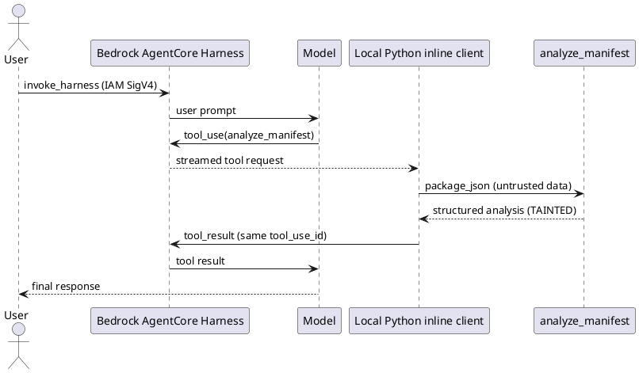

> **Classification: CONFIDENTIAL** — Contains workload security details. Restrict distribution.

# Well-Architected Review: DepGuard Sentinel

> **Document state: PARTIAL WORKING RECORD — BASELINE EVIDENCE RECONSTRUCTED FROM HISTORICAL IAM v1; NOT A COMPLETED OFFICIAL SKILL REPORT.**
> The official `aws-well-architected-review` skill has not completed a full workload review in this workstream. Do not present this document as an official score or complete review.

## Coverage Audit

| Coverage measure | Result |
|---|---|
| Security BP documentation pages collected/reconciled | 52/52 |
| Security BP workload assessments completed by a formal skill run | 0/52 |
| Scoped manual IAM observations | 1 (SEC03-BP01-related permission statement) |
| Pillars assessed end-to-end | 0 |
| Formal findings produced by the skill | 0 |
| Official maturity score | Not calculated |

The 52/52 figure refers to documentation acquisition and reconciliation, not implementation assessment. The documentation inventory was marked `PASS WITH LIMITATIONS`: a local table-of-contents copy was used and the documentation MCP did not provide enough response-length metadata to claim a formal numerical truncation gate.

## Executive Summary

- **Workload**: DepGuard Sentinel
- **Pillar in scope for document preparation**: Security
- **Security questions in inventory**: 11 (SEC01–SEC11)
- **Security best practices in inventory**: 52
- **Questions assessed by the completed official skill workflow**: 0/11
- **Best practices assessed by the completed official skill workflow**: 0/52
- **Official findings/severities**: None generated
- **Overall maturity**: NOT SCORED — insufficient workload assessment evidence

This record preserves one manually verified IAM configuration observation associated with SEC03-BP01. It does not assign an official severity or claim full BP compliance.

## Architecture Overview

Known architecture and invocation evidence from the work performed:

- An AWS Bedrock AgentCore Harness named `DepGuardSentinel` (version 2, status READY) fronts the agent invocation.
- The AgentCore Runtime named `harness_DepGuardSentinel` was observed READY, version 2, with network mode PUBLIC.
- The Harness allowed tool list contained `@analyze_manifest`.
- Invocation used IAM SigV4; `AuthorizerConfigured=false` refers to no custom JWT authorizer and does not mean anonymous invocation.
- The Python client performs the inline tool handoff locally, executes only the allowlisted `analyze_manifest`, and returns a tool result correlated by `tool_use_id`.
- The manifest analyzer treats manifest content as untrusted input and returns `trust_state: TAINTED`.

The diagram is an evidence-based high-level flow, not a complete deployment diagram. Detailed network, storage, logging, and account-boundary elements remain to be assessed.

## Pillar Scorecard

| Pillar | Score (1–5) | Questions assessed | Key strength | Key gap |
|---|---:|---:|---|---|
| Security | Not scored | 0/11 formal | One IAM least-privilege statement was remediated and simulated | Full 52-BP workload assessment is not complete |
| Reliability | Not assessed | 0 | Not assessed | Not assessed |
| Operational Excellence | Not assessed | 0 | Not assessed | Not assessed |
| Performance Efficiency | Not assessed | 0 | Not assessed | Not assessed |
| Cost Optimization | Not assessed | 0 | Not assessed | Not assessed |
| Sustainability | Not assessed | 0 | Not assessed | Not assessed |

## Per-Question Assessment

| ID | Question | Status | Risk level | Key evidence |
|---|---|---|---|---|
| SEC01 | Security question title not reproduced in this scaffold | Not assessed | Not scored | Formal skill workload assessment not yet executed |
| SEC02 | Security question title not reproduced in this scaffold | Not assessed | Not scored | Formal skill workload assessment not yet executed |
| SEC03 | Security question title not reproduced in this scaffold | Not assessed | Not scored | Formal skill workload assessment not yet executed |
| SEC04 | Security question title not reproduced in this scaffold | Not assessed | Not scored | Formal skill workload assessment not yet executed |
| SEC05 | Security question title not reproduced in this scaffold | Not assessed | Not scored | Formal skill workload assessment not yet executed |
| SEC06 | Security question title not reproduced in this scaffold | Not assessed | Not scored | Formal skill workload assessment not yet executed |
| SEC07 | Security question title not reproduced in this scaffold | Not assessed | Not scored | Formal skill workload assessment not yet executed |
| SEC08 | Security question title not reproduced in this scaffold | Not assessed | Not scored | Formal skill workload assessment not yet executed |
| SEC09 | Security question title not reproduced in this scaffold | Not assessed | Not scored | Formal skill workload assessment not yet executed |
| SEC10 | Security question title not reproduced in this scaffold | Not assessed | Not scored | Formal skill workload assessment not yet executed |
| SEC11 | Security question title not reproduced in this scaffold | Not assessed | Not scored | Formal skill workload assessment not yet executed |

Question titles must be populated from the exact live inventory used by the official skill. They are intentionally not guessed in this scaffold.

## Full BP Ledger (MANDATORY FOR A COMPLETED REVIEW)

The following is an inventory scaffold, not a completed assessment. Every row remains `Cannot Determine` until the official workflow evaluates the workload and records file/line or AWS resource evidence.

| BP ID | Pillar | Status | Risk level | Evidence | Recommendation |
|---|---|---|---|---|---|
| SEC01-BP01 | Security | Cannot Determine | Not assigned | BP-level workload evidence not assessed by completed skill run | Retrieve title/evidence and assess using the official skill |
| SEC01-BP02 | Security | Cannot Determine | Not assigned | BP-level workload evidence not assessed by completed skill run | Retrieve title/evidence and assess using the official skill |
| SEC01-BP03 | Security | Cannot Determine | Not assigned | BP-level workload evidence not assessed by completed skill run | Retrieve title/evidence and assess using the official skill |
| SEC01-BP04 | Security | Cannot Determine | Not assigned | BP-level workload evidence not assessed by completed skill run | Retrieve title/evidence and assess using the official skill |
| SEC01-BP05 | Security | Cannot Determine | Not assigned | BP-level workload evidence not assessed by completed skill run | Retrieve title/evidence and assess using the official skill |
| SEC01-BP06 | Security | Cannot Determine | Not assigned | BP-level workload evidence not assessed by completed skill run | Retrieve title/evidence and assess using the official skill |
| SEC01-BP07 | Security | Cannot Determine | Not assigned | BP-level workload evidence not assessed by completed skill run | Retrieve title/evidence and assess using the official skill |
| SEC02-BP01 | Security | Cannot Determine | Not assigned | BP-level workload evidence not assessed by completed skill run | Retrieve title/evidence and assess using the official skill |
| SEC02-BP02 | Security | Cannot Determine | Not assigned | BP-level workload evidence not assessed by completed skill run | Retrieve title/evidence and assess using the official skill |
| SEC02-BP03 | Security | Cannot Determine | Not assigned | BP-level workload evidence not assessed by completed skill run | Retrieve title/evidence and assess using the official skill |
| SEC02-BP04 | Security | Cannot Determine | Not assigned | BP-level workload evidence not assessed by completed skill run | Retrieve title/evidence and assess using the official skill |
| SEC02-BP05 | Security | Cannot Determine | Not assigned | BP-level workload evidence not assessed by completed skill run | Retrieve title/evidence and assess using the official skill |
| SEC03-BP01 | Security | Cannot Determine | Not assigned | BP-level workload evidence not assessed by completed skill run | Retrieve title/evidence and assess using the official skill |
| SEC03-BP02 | Security | Cannot Determine | Not assigned | BP-level workload evidence not assessed by completed skill run | Retrieve title/evidence and assess using the official skill |
| SEC03-BP03 | Security | Cannot Determine | Not assigned | BP-level workload evidence not assessed by completed skill run | Retrieve title/evidence and assess using the official skill |
| SEC03-BP04 | Security | Cannot Determine | Not assigned | BP-level workload evidence not assessed by completed skill run | Retrieve title/evidence and assess using the official skill |
| SEC03-BP05 | Security | Cannot Determine | Not assigned | BP-level workload evidence not assessed by completed skill run | Retrieve title/evidence and assess using the official skill |
| SEC04-BP01 | Security | Cannot Determine | Not assigned | BP-level workload evidence not assessed by completed skill run | Retrieve title/evidence and assess using the official skill |
| SEC04-BP02 | Security | Cannot Determine | Not assigned | BP-level workload evidence not assessed by completed skill run | Retrieve title/evidence and assess using the official skill |
| SEC05-BP01 | Security | Cannot Determine | Not assigned | BP-level workload evidence not assessed by completed skill run | Retrieve title/evidence and assess using the official skill |
| SEC05-BP02 | Security | Cannot Determine | Not assigned | BP-level workload evidence not assessed by completed skill run | Retrieve title/evidence and assess using the official skill |
| SEC05-BP03 | Security | Cannot Determine | Not assigned | BP-level workload evidence not assessed by completed skill run | Retrieve title/evidence and assess using the official skill |
| SEC05-BP04 | Security | Cannot Determine | Not assigned | BP-level workload evidence not assessed by completed skill run | Retrieve title/evidence and assess using the official skill |
| SEC06-BP01 | Security | Cannot Determine | Not assigned | BP-level workload evidence not assessed by completed skill run | Retrieve title/evidence and assess using the official skill |
| SEC06-BP02 | Security | Cannot Determine | Not assigned | BP-level workload evidence not assessed by completed skill run | Retrieve title/evidence and assess using the official skill |
| SEC06-BP03 | Security | Cannot Determine | Not assigned | BP-level workload evidence not assessed by completed skill run | Retrieve title/evidence and assess using the official skill |
| SEC06-BP04 | Security | Cannot Determine | Not assigned | BP-level workload evidence not assessed by completed skill run | Retrieve title/evidence and assess using the official skill |
| SEC06-BP05 | Security | Cannot Determine | Not assigned | BP-level workload evidence not assessed by completed skill run | Retrieve title/evidence and assess using the official skill |
| SEC07-BP01 | Security | Cannot Determine | Not assigned | BP-level workload evidence not assessed by completed skill run | Retrieve title/evidence and assess using the official skill |
| SEC07-BP02 | Security | Cannot Determine | Not assigned | BP-level workload evidence not assessed by completed skill run | Retrieve title/evidence and assess using the official skill |
| SEC07-BP03 | Security | Cannot Determine | Not assigned | BP-level workload evidence not assessed by completed skill run | Retrieve title/evidence and assess using the official skill |
| SEC07-BP04 | Security | Cannot Determine | Not assigned | BP-level workload evidence not assessed by completed skill run | Retrieve title/evidence and assess using the official skill |
| SEC08-BP01 | Security | Cannot Determine | Not assigned | BP-level workload evidence not assessed by completed skill run | Retrieve title/evidence and assess using the official skill |
| SEC08-BP02 | Security | Cannot Determine | Not assigned | BP-level workload evidence not assessed by completed skill run | Retrieve title/evidence and assess using the official skill |
| SEC08-BP03 | Security | Cannot Determine | Not assigned | BP-level workload evidence not assessed by completed skill run | Retrieve title/evidence and assess using the official skill |
| SEC08-BP04 | Security | Cannot Determine | Not assigned | BP-level workload evidence not assessed by completed skill run | Retrieve title/evidence and assess using the official skill |
| SEC09-BP01 | Security | Cannot Determine | Not assigned | BP-level workload evidence not assessed by completed skill run | Retrieve title/evidence and assess using the official skill |
| SEC09-BP02 | Security | Cannot Determine | Not assigned | BP-level workload evidence not assessed by completed skill run | Retrieve title/evidence and assess using the official skill |
| SEC09-BP03 | Security | Cannot Determine | Not assigned | BP-level workload evidence not assessed by completed skill run | Retrieve title/evidence and assess using the official skill |
| SEC10-BP01 | Security | Cannot Determine | Not assigned | BP-level workload evidence not assessed by completed skill run | Retrieve title/evidence and assess using the official skill |
| SEC10-BP02 | Security | Cannot Determine | Not assigned | BP-level workload evidence not assessed by completed skill run | Retrieve title/evidence and assess using the official skill |
| SEC10-BP03 | Security | Cannot Determine | Not assigned | BP-level workload evidence not assessed by completed skill run | Retrieve title/evidence and assess using the official skill |
| SEC10-BP04 | Security | Cannot Determine | Not assigned | BP-level workload evidence not assessed by completed skill run | Retrieve title/evidence and assess using the official skill |
| SEC10-BP05 | Security | Cannot Determine | Not assigned | BP-level workload evidence not assessed by completed skill run | Retrieve title/evidence and assess using the official skill |
| SEC11-BP01 | Security | Cannot Determine | Not assigned | BP-level workload evidence not assessed by completed skill run | Retrieve title/evidence and assess using the official skill |
| SEC11-BP02 | Security | Cannot Determine | Not assigned | BP-level workload evidence not assessed by completed skill run | Retrieve title/evidence and assess using the official skill |
| SEC11-BP03 | Security | Cannot Determine | Not assigned | BP-level workload evidence not assessed by completed skill run | Retrieve title/evidence and assess using the official skill |
| SEC11-BP04 | Security | Cannot Determine | Not assigned | BP-level workload evidence not assessed by completed skill run | Retrieve title/evidence and assess using the official skill |
| SEC11-BP05 | Security | Cannot Determine | Not assigned | BP-level workload evidence not assessed by completed skill run | Retrieve title/evidence and assess using the official skill |
| SEC11-BP06 | Security | Cannot Determine | Not assigned | BP-level workload evidence not assessed by completed skill run | Retrieve title/evidence and assess using the official skill |
| SEC11-BP07 | Security | Cannot Determine | Not assigned | BP-level workload evidence not assessed by completed skill run | Retrieve title/evidence and assess using the official skill |
| SEC11-BP08 | Security | Cannot Determine | Not assigned | BP-level workload evidence not assessed by completed skill run | Retrieve title/evidence and assess using the official skill |

Ledger rows: 52. The row count matches the 52 collected Security BP documentation pages. Titles, status, risk level, evidence, and recommendations still require formal assessment.

## Critical and High Risk Findings

No Critical or High findings have been generated by the official skill run. Do not infer a severity from the manually observed IAM issue.

## Medium Risk Findings

No Medium findings have been generated by the official skill run.

## Low Risk Findings

No Low findings have been generated by the official skill run.

## Cross-Pillar Trade-offs

Not assessed. No cross-pillar review has been completed.

## Prioritize Improvements — Eisenhower Matrix

One manually selected improvement is documented separately: restrict the `sts:GetServiceBearerToken` statement to ECR Public. It is a candidate remediation associated with SEC03-BP01, not an official skill finding with a confirmed risk rating.

## Prioritized Remediation Plan

| Item | Action | State |
|---|---|---|
| IAM statement restriction | Compare v1/v2 and validate with IAM policy simulator | Before state: open; see evidence register |
| Full Security assessment | Run official skill against workload; evaluate all 52 BPs | Pending |
| Other pillars | Assess only if required by hackathon scope | Pending / scope confirmation |

## Next Steps

1. Run the official skill end-to-end and preserve its coverage audit.
2. Populate question titles and every BP ledger row from the skill's live inventory.
3. Assign findings and severity only where evidence supports them.
4. Keep the historical IAM v1 and active v2 outputs as separate evidence.
5. Do not calculate maturity until the skill's documented scoring procedure is completed.

## Scoped manual observation F-001 (not an official skill finding)

- **Reference**: SEC03-BP01-related least-privilege observation
- **Severity**: Not assigned
- **State at baseline**: Open
- **Resource**: `arn:aws:iam::634393785889:policy/DepGuardSentinelExecutionPolicy`, version `v1`
- **Statement**: `PublicContainerBearerToken`
- **Evidence**: historical `get-policy-version --version-id v1` output showed `Effect: Allow`, `Action: sts:GetServiceBearerToken`, `Resource: *`, with no `Condition` element.
- **File/line**: Not applicable; this evidence is an AWS-managed IAM policy version, not a repository file.
- **Limitation**: This single statement does not establish the full compliance state of SEC03-BP01 or the entire execution role.
